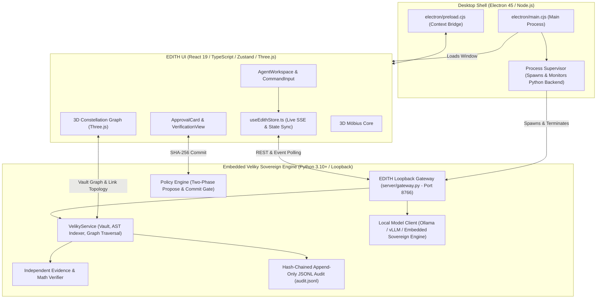

# EDITH — Sovereign Personal AI Operating System

EDITH is a desktop-first, goal-driven Sovereign AI Operating System interface and execution workbench. It embeds the **Veliky Sovereign AI Pipeline** inside an air-gapped, permissioned loopback backend and packages as a native **Electron desktop application**.

---

## Architecture & Integration



### Cognitive Execution Loop
1. **SEE & UNDERSTAND**: Inspects repository layout, active workspace files, and indexed knowledge notes.
2. **PLAN**: Decomposes the user's high-level goal into an execution sequence.
3. **REASON**: Dispatches turns to the sovereign agent engine or local OpenAI-compatible inference (Ollama `qwen2.5` / `deepseek-r1`) or the embedded sovereign engine with zero external telemetry.
4. **ACT & PROPOSE**: Proposes workspace file mutations or reports with a cryptographic SHA-256 integrity hash.
5. **HUMAN-IN-THE-LOOP APPROVAL**: The agent halts execution until the human signs the change.
6. **VERIFY & AUDIT**: Validates results against evidence IDs and appends a tamper-evident hash-chained record to `audit.jsonl`.

---

## Sovereign Intelligence Engine Integration

EDITH natively embeds an advanced autonomous sovereign execution engine as its primary backend intelligence:

- **Automatic Kernel Discovery**: `server/gateway.py` automatically detects the execution binary in the environment.
- **Stream-JSON Architecture**: Dispatches turns via structured schema streams, capturing real-time agent tool invocations (`read_file`, `run_command`, AST lookups) and streaming them straight to EDITH's execution log.
- **Model Routing**: Supports selectable models including:
  - `gemini-3.8-flash-high` (Default - High Reasoning)
  - `gemini-3.8-flash-medium` (Balanced)
  - `gemini-3.8-flash-low` (Fast)
  - `claude-sonnet-4-6` (Thinking)
  - `claude-opus-4-6-thinking` (Deep Reasoning)
  - `gpt-oss-120b-medium` (Medium)
- **Sovereign Approval Gate**: Execution proposals adhere to the strict two-phase commit protocol:
  1. The engine formulates a structured mutation proposal containing target file, action (`create_file`, `modify_file`, `report`), content, and rationale.
  2. The proposal is locked behind a cryptographic SHA-256 digest in EDITH's UI (`ApprovalCard`).
  3. On user approval, the loopback gateway commits the change directly to the local workspace with hash-chained provenance recorded in `audit.jsonl`.

---

## Getting Started

### 1. Requirements
- Node.js 20+ (Node 26 recommended)
- Python 3.10+
- (Optional) Local Ollama or vLLM running on `http://127.0.0.1:11434` or `http://127.0.0.1:8000`

### 2. Run the Electron Desktop App
```bash
# Launch Vite dev server + Sovereign Engine + Electron together
npm run electron:dev
```

### 3. Run in Production Desktop Mode
```bash
# Build production bundle and launch Electron desktop app
npm run electron:preview
```

### 4. Run Web Mode (Browser-only)
```bash
# Terminal 1: Start the Python Sovereign Engine
python3 server/gateway.py --port 8766

# Terminal 2: Start the frontend
npm run dev
```

---

## Quality Assurance & Verification
Run the regression suite:
```bash
npm run typecheck
npm run build
npm run qa:browser
npm run qa:a11y
```


## Google Authentication

EDITH includes an integrated end-to-end Google OAuth 2.0 / Google Identity Services authentication system across both frontend, Electron desktop shell, and the Sovereign Loopback Gateway:

1. **Configuration**:
   - Copy `.env.example` to `.env`:
     ```bash
     cp .env.example .env
     ```
   - Set `VITE_GOOGLE_CLIENT_ID` (and optionally `GOOGLE_CLIENT_ID`) to your Google OAuth 2.0 Web Client ID.
   - In Google Cloud Console (*APIs & Services > Credentials*), add your origins:
     - Authorized JavaScript origins: `http://localhost:5173`, `http://127.0.0.1:5173`
   - Restart Vite / Sovereign Gateway (`npm run dev` or `npm run electron:dev`).

2. **In-App Client ID Setup & Instant Google Login**:
   - If not set in `.env`, clicking **Sign in with Google** opens the Google Authentication dialog where you can connect your Client ID on the fly (persisted to local browser storage), or use **Instant Google Sign-In (Demo Profile)** for instant local preview with realistic Google OAuth identity.

3. **Backend Cryptographic Verification**:
   - The Sovereign Gateway exposes `/api/auth/google`, `/api/auth/session`, `/api/auth/logout`, and `/api/auth/config`.
   - Credentials are submitted and verified server-side via Google's OAuth2 verification endpoint (with resilient offline fallback), returning a cryptographic session token.
   - Authentication events are recorded to the tamper-evident append-only audit trail (`audit.jsonl`).

4. **Session Persistence**:
   - Google sessions and tokens persist across page reloads and browser restarts. Signing out terminates the backend session and clears local credentials.

5. **Desktop (Electron) Compatibility**:
   - The Electron main process sanitizes the User-Agent header, preventing Google's `403: disallowed_useragent` error and allowing Google Identity popups to load natively.

## Opening a real local project

Use **Open Project Folder**. Modern Chromium browsers provide the selected folder files to the frontend through `webkitdirectory`.

EDITH then:

1. Builds the workspace file tree.
2. Reads supported text/code files up to safe prototype limits.
3. Detects common languages/framework markers.
4. Builds `contains` edges from folders.
5. Attempts to derive `imports` relationships from source text.
6. Uses those nodes as the 3D graph instead of the fallback mock graph.

This remains a frontend prototype. It does not silently write to disk, execute shell commands, or run an LLM. Controlled execution is represented by the UI state machine until a real backend agent/tool layer is connected.

## Keyboard controls

- `Enter` — execute goal
- `Shift + Enter` — newline
- `Alt + ↑ / ↓` — command history
- `Esc` — return to EDITH from Workspace / Graph / Memory / Activity
- Graph: drag to orbit, scroll to zoom, click nodes to focus

## Structure

```text
src/
├── components/
│   ├── agent/
│   ├── graph/
│   ├── mobius/
│   ├── files/
│   ├── memory/
│   ├── activity/
│   ├── layout/
│   └── profile/
├── lib/
│   ├── api.ts
│   ├── types.ts
│   └── workspace.ts
├── mock/
├── pages/
├── store/
└── styles.css
```
